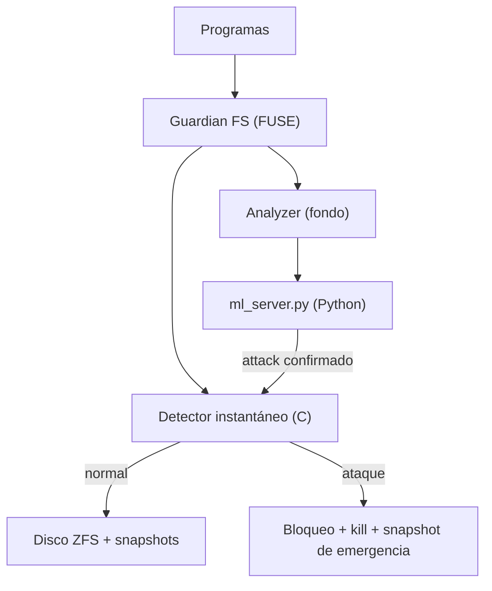

# Arquitectura de Guardian FS — documento maestro

> Esta página es el panorama general: qué protege, contra quién, con qué estructura y con qué objetivos medibles. El detalle está repartido en documentos enfocados: [diagramas de flujo](../pipeline.md), [guía de desarrolladores](../developer-guide.md), [guía de ML](../ml-architecture.md), [guía de tests](../testing-guide.md) y [qué verifica cada test](../tests.md).

---

## 1. Qué es, en una frase

Guardian FS es un **filtro de filesystem** para Linux: se interpone entre los programas y el disco, analiza cada operación de escritura en menos de un milisegundo y, si reconoce el patrón de un ransomware cifrando archivos, lo bloquea, mata al atacante y deja tomada una "fotografía" del disco (snapshot de ZFS) para poder deshacer el daño en segundos.

**Los tres pilares:**

| Pilar | Cómo |
|---|---|
| **Detectar a tiempo** | Análisis estadístico en C dentro de cada escritura (entropía, uniformidad, velocidad, renombrados) + segunda opinión de ML cada 5 s |
| **Frenar de verdad** | La escritura bloqueada nunca llega al disco; el atacante recibe SIGKILL |
| **Deshacer el daño** | Snapshots automáticos cada 60 s + snapshot de emergencia al primer aviso; rollback en ~1 s |

## 2. Objetivos medibles de la PoC

| Objetivo | Valor |
|---|---|
| Datos perdidos antes del freno | < 1 MB |
| Tiempo de recuperación (rollback) | < 30 s (medido: ~1 s) |
| Costo de los snapshots | < 5% del dataset |
| Falsos positivos | < 1% |
| Latencia añadida por operación | < 2 ms |

## 3. Estructura del sistema

Tres hilos en el daemon: el principal atiende las operaciones de archivo; el analyzer resume ventanas de 5 segundos y consulta al ML; el planificador saca snapshots cada 60 segundos. La comunicación con Python es por socket local con mensajes JSON, y el sistema **sigue funcionando con el ML caído** (degrada a reglas estadísticas puras).

El detalle de cada módulo, con su porqué, está en la [guía de desarrolladores](../developer-guide.md) §3.

## 4. Modelo de amenazas

### Qué protegemos

| Activo | Valor | Nota |
|---|---|---|
| Archivos del usuario en `/mnt/protected` | Alto | Es el objetivo directo del ataque |
| Snapshots ZFS | Muy alto | Son el único mecanismo de recuperación |
| Estructura del filesystem | Alto | Metadatos incluidos |
| Modelos ML entrenados | Medio | Reentrenables desde el dataset |

### Contra quién

| Perfil | Qué hace | Ejemplo |
|---|---|---|
| Oportunista | Ejecuta ransomware conocido tal cual | LockBit 3.0 estándar |
| Evasivo | Baja la velocidad, cifra parcial, duerme entre archivos | Cifrado de los primeros N KB con sleeps |
| Dirigido | **Conoce Guardian FS** y busca bypassearlo | Escribe tráfico "benigno" de cobertura, ataca los señuelos o el socket ML |

### Amenazas identificadas y cómo se mitigan

| # | Amenaza | Mitigación actual | Estado |
|---|---|---|---|
| T1 | Ransomware que recorre los archivos en orden inverso/aleatorio y esquiva los señuelos | Señuelos en ambos extremos del abecedario (`A_…` y `ZZ_…`) + uno oculto | ✔ Parcial — cubrir más órdenes de recorrido |
| T2 | Cifrado lento para no disparar las tasas | La entropía no depende de la velocidad; el ML ve la ventana completa | ✔ |
| T3 | Ataque al socket del ML (saturación) | Socket local con permisos restrictivos | Parcial — sin autenticación |
| T4 | Borrar los señuelos antes de cifrar | El borrado de un señuelo es bloqueo inmediato + señuelo oculto | ✔ |
| T5 | Molestar trabajo legítimo (backups, builds) | Discriminación de intención en señuelos, χ² anti-FP, modo sombra para medir FPs | ✔ Parcial — ver T13 |
| T6 | Agotar el disco con snapshots | Retención acotada (20 automáticos, 10 de emergencia) | ✔ |
| T7 | Un rollback borra trabajo legítimo posterior | El rollback es una decisión manual del administrador | ✔ (por diseño) |
| T8 | Cifrar los archivos por un camino que no pase por el filtro | El punto de montaje FUSE debe ser la única entrada al dataset | ⚠ Depende de la configuración de montaje |
| T9 | Desmontar FUSE y montar ZFS directo | Requiere privilegios de administrador | ⚠ Fuera del modelo de la PoC |
| T10 | El servidor ML no está / se cae | Degradación a reglas estadísticas puras | ✔ |
| T11 | Ransomware que solo renombra sin cifrar | Detección por tasa de cambio de extensión | ✔ Parcial |
| T12 | Ransomware nuevo que el ML nunca vio | Isolation Forest detecta rarezas sin ejemplos previos | ✔ |
| T13 | `rsync` masivo dentro del mount dispara la regla de renombrados (por sus archivos temporales) | — | ✖ Pendiente de decisión (umbral o lista blanca de patrones tmp) |

## 5. Decisiones técnicas (resumen de una línea)

| Decisión | Por qué (una línea) |
|---|---|
| FUSE y no módulo de kernel | Un bug no paniquea el sistema; se desarrolla y debuggea como un programa normal |
| Detección síncrona en C | El presupuesto de tiempo dentro de una escritura se mide en microsegundos |
| ZFS y no btrfs/LVM | Snapshots instantáneos, inmutables y rollback inmediato |
| Señuelos + estadística + ML | Tres capas con debilidades distintas: evadir las tres a la vez es mucho más difícil |
| ML asíncrono y veto imposible | La disponibilidad no puede depender de un proceso de Python; el ML confirma ataques, nunca desbloquea |
| Ventanas por programa | Un atacante no puede esconderse detrás de la actividad de otros procesos |

El razonamiento completo de cada una: [guía de desarrolladores](../developer-guide.md) §6.

## 6. Estado actual

Todo el código C y Python está implementado, compilado sin warnings y con 62 tests pasando. El circuito completo (montaje sobre ZFS, recolección de datos, entrenamiento, detección de punta a punta y rollback) fue validado en VM — el detalle con métricas y la lista de incidentes resueltos está en la [bitácora de la última sesión](../cambios-2026-11-04.md).

Los pendientes vivos (configuración por archivo, apagado ordenado, integration tests automatizados, freno por usuario, T13) se administran en [`docs/pending.md`](../pending.md).
