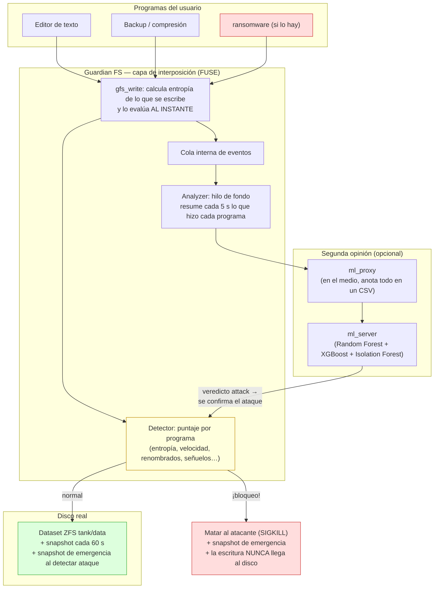
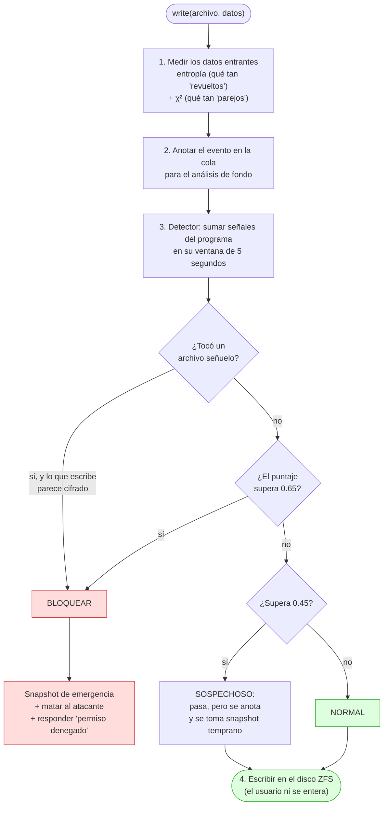
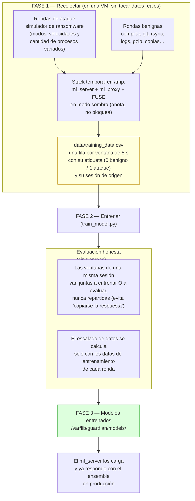
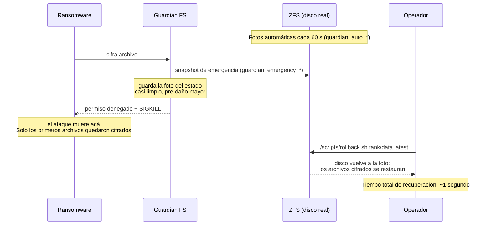
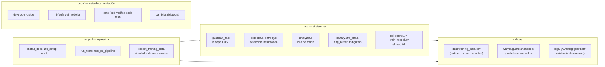

# Cómo funciona Guardian FS — diagramas del pipeline

Esta página muestra el flujo completo del sistema con diagramas. Se leen de arriba hacia abajo y siguen el camino real que recorre una operación de archivo.

> Si preferís texto antes que diagramas, el detalle módulo por módulo está en [`docs/developer-guide.md`](developer-guide.md).

---

## 1. Vista general: el sistema montado

Guardian FS se instala como una "capa" entre los programas y el disco real. Los programas guardan archivos en `/mnt/protected` sin saber que alguien revisa lo que escriben; detrás, los datos terminan en un dataset ZFS que además se fotografía (snapshots) cada 60 segundos.

**Tres cosas clave del diseño:**

1. **La decisión rápida es local y síncrona** (el detector C): ocurre dentro de la misma operación de escritura, en menos de un milisegundo. Por eso puede frenar el ataque antes de que los bytes cifrados toquen el disco.
2. **La opinión del ML llega después** (asíncrona): el analyzer resume ventanas de 5 segundos y se las manda al servidor Python. Si el ML dice "ataque", el detector queda avisado y bloquea al atacante en su próxima operación. El ML **refina**, nunca reemplaza al detector.
3. **Todo funciona aunque falte el ML**: si el servidor Python no está, el sistema degrada a detección estadística pura. La seguridad no depende de un proceso de Python.

---

## 2. Qué pasa en cada escritura, paso a paso

Este es el corazón del sistema: cada vez que cualquier programa escribe un archivo, se recorre este camino.

**Ejemplo concreto:**

- Guardás un documento desde LibreOffice → entropía ~4.5 → puntaje bajo → se escribe normal.
- Comprimís una carpeta con `gzip` → entropía alta (~7.9) pero el χ² muestra estructura interna → **no** se bloquea (esta distinción es clave para no molestar backups).
- Un ransomware cifra archivos → entropía ~8.0 **y** χ² parejo **y** renombrados con cambio de extensión **y** varios directorios recorridos → puntaje alto → bloqueo + kill + snapshot.

---

## 3. Pipeline de datos y entrenamiento del ML

El modelo no nace solo: hay que generarle datos. Este flujo es el que se automatiza con `scripts/collect_training_data.sh`.

**Por qué el "modo sombra"**: si el atacante simulado muriera en su primera ventana (como pasa en modo real), solo veríamos una fila por ataque. En modo sombra el sistema anota todo sin bloquear ni matar, y cada ataque aporta muchas filas: las de su inicio, desarrollo y captura.

**Un detalle que costó descubrir**: las clases de ejemplos benignos tienen que cubrir los casos *difíciles* — programas que escriben datos muy "revueltos" sin ser atacantes (comprimir, guardar multimedia). Si una clase falta del dataset, el modelo etiqueta mal a esos programas. Por eso las rondas benignas incluyen gzip de archivos grandes, compilaciones, escritura de bloques idénticos, etc.

---

## 4. Recuperación después de un ataque

Detectar y matar al atacante es la mitad del trabajo; la otra mitad es volver al estado de antes. Los snapshots de ZFS funcionan como fotos del disco: tomar la foto es instantáneo porque no copia datos, solo anota "desde acá, si algo cambia, se guarda en otro lado".

**Las dos fotos que importan:**

| Snapshot | Cuándo se toma | Para qué sirve |
|---|---|---|
| `guardian_auto_*` (cada 60 s) | Siempre, en fondo | Red de seguridad ante cualquier problema (no solo ransomware) |
| `guardian_emergency_*` | En la primera sospecha y en cada bloqueo | Congela el estado justo antes del daño mayor: minimiza cuántos archivos hay que recuperar |

---

## 5. Mapa de repositorio (dónde está cada cosa)

